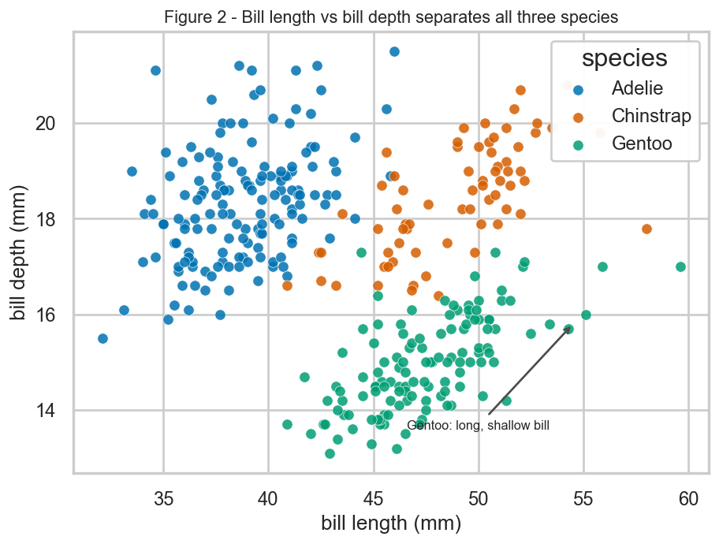
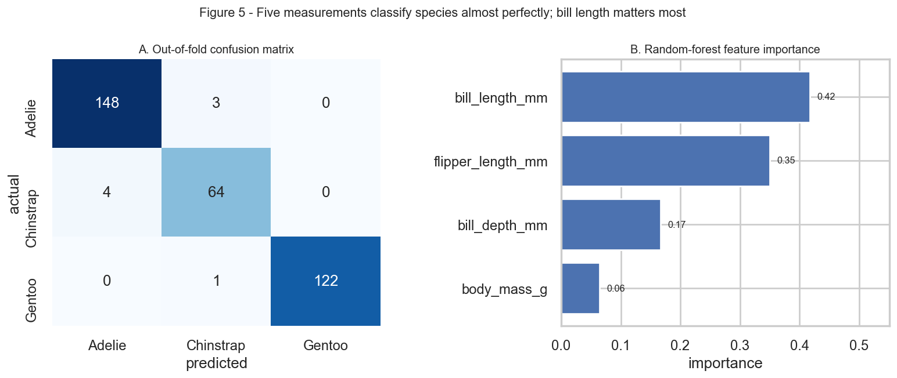

# Data Science Portfolio

**Practice 09 — Data Science**

> ✅ **Live on GitHub Pages** · Python · pandas · scikit-learn · Matplotlib · Reproducible analysis

---

## About me

I am a data science student. I am
interested in turning messy raw data into findings that someone else can actually
reproduce and check. My work so far focuses on the full analysis loop: cleaning and
profiling a dataset, choosing a method that fits the question rather than the other
way round, and being explicit about what the data cannot support.

This portfolio is published with **GitHub Pages** and documents one completed project
end to end. Every number below is produced by running the repository's own script —
nothing is typed in by hand.

---

## Technical skills

| Area | Tools and experience |
|---|---|
| **Languages** | Python (primary), SQL, Markdown, Bash/PowerShell basics |
| **Data wrangling** | pandas, NumPy — cleaning, missing-value handling, joins, derived features |
| **Modelling** | scikit-learn — logistic regression, random forests, cross-validation, evaluation metrics |
| **Visualisation** | Matplotlib, Seaborn — exploratory plots and publication-ready figures |
| **Reproducibility** | Git and GitHub, pinned requirements, fixed random seeds, Jupyter notebooks |
| **Publishing** | GitHub Pages, Markdown authoring, technical documentation |

---

## Project showcase

### Can body measurements predict penguin species?

**Status: completed** · Classification · 342 records · 3 species

#### Research question

Given only a penguin's **bill length, bill depth, flipper length and body mass**, can
we identify its species — and which of those measurements carries the most
information?

The motivation is practical: morphometric measurements are cheap to collect, whereas
genetic or behavioural species identification is expensive. If a few caliper and
scale readings separate the species reliably, field surveys can be partly automated
and mislabelled records flagged for review.

#### Visualisation and findings



**Figure 1 — Bill length versus bill depth.** The three species occupy almost disjoint
regions. Gentoo (green) is separated on bill shape alone — a long but notably shallow
bill. Adelie and Chinstrap share a deep bill and are separated mainly by length.

Two findings stand out:

1. **Measurements alone identify species almost perfectly.** A scaled logistic
   regression reached **98.8% ± 1.1%** 5-fold cross-validated accuracy, and a 400-tree
   random forest reached 97.7% ± 1.2%.
2. **Bill length is the single most informative measurement** (random-forest
   importance 0.42), followed by flipper length (0.35), bill depth (0.17) and body
   mass (0.06).

| Species | Bill length | Bill depth | Flipper length | Body mass | n |
|---|---:|---:|---:|---:|---:|
| Adelie | 38.8 mm | 18.4 mm | 190.0 mm | 3,701 g | 151 |
| Chinstrap | 48.8 mm | 18.4 mm | 195.8 mm | 3,733 g | 68 |
| **Gentoo** | 47.5 mm | **15.0 mm** | **217.2 mm** | **5,076 g** | 123 |

*Mean measurements per species. Gentoo is the easiest to identify because it is
separated on both axes at once: roughly 27 mm more flipper and 1.4 kg heavier than
Adelie, with a uniquely shallow bill.*



**Figure 2 — Model performance.** Left: out-of-fold confusion matrix — only 8 of 342
individuals are misclassified, and every error is an Adelie/Chinstrap confusion.
Right: feature-importance ranking.

#### One limitation

> ⚠️ **The result describes these islands, not penguins in general.** Species and
> island are almost perfectly aligned in this dataset: Gentoo appears only on Biscoe
> and Chinstrap only on Dream. A classifier therefore cannot distinguish "this is a
> Gentoo" from "this was measured on Biscoe", so the 98.8% figure is confounded by
> location.
>
> A second, smaller issue: 26 of the 68 Chinstrap penguins have a bill length in the
> 42–48 mm band where Adelie also occurs, and the two species differ by only 0.07 mm
> in mean bill depth — so that feature cannot help separate them. Both limitations are
> quantified in the repository README.

#### Dataset

Palmer Archipelago (Antarctica) penguins — 344 individuals, 3 species, 3 islands,
collected 2007–2009. Released under **CC0 1.0** (public domain), so it is safe to
redistribute. Original study: Gorman, Williams & Fraser (2014), *PLoS ONE* 9(3):
e90081.

#### Links

- 🔗 **[Project repository](https://github.com/ZHU-QINYI/data-science-project)**
- 📄 **[README with full methodology](https://github.com/ZHU-QINYI/data-science-project/blob/main/README.md)**

---

## How to reproduce this result

Every figure and number on this page comes from one script:

```bash
git clone https://github.com/ZHU-QINYI/data-science-project.git
cd data-science-project
pip install -r requirements.txt
python analysis.py
```

The script is deterministic (`RANDOM_STATE = 42`), so re-running it reproduces the
reported metrics exactly.

---

## What I will improve next

- **Test the confounding directly.** Re-run the model with island removed or balanced
  across species, to measure how much of the accuracy is really coming from species
  rather than location.
- **Add a second project** on a messier dataset with genuine missing data and
  unbalanced groups, since this one is unusually clean and its ceiling is reached
  almost immediately.
- **Report uncertainty properly.** Replace the single held-out split with repeated
  nested cross-validation, and quote confidence intervals rather than a single 100%
  test score that is really just a small-sample artefact.

---

**CISC7204 Practice 09 — Data Science Portfolio**

*Built with GitHub Pages. Code under the MIT Licence; the penguins dataset is CC0 1.0.
No sensitive information is published on this site.*
